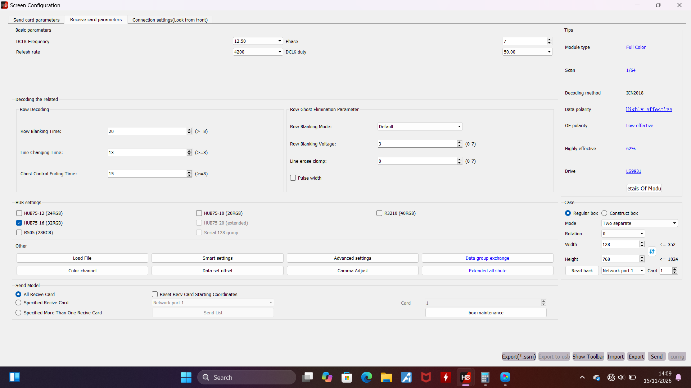
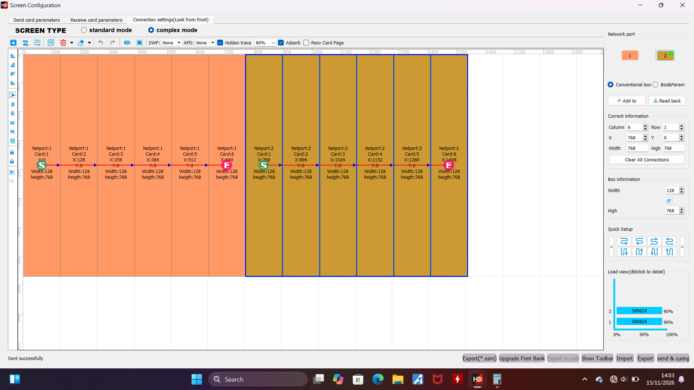

# 🖼️ Folder `image/`

Folder ini berisi dokumentasi visual yang mendukung proses konfigurasi dan pemasangan **Videotron SMA Negeri 1 Badegan**.

---

## 📷 Isi Folder

- **Gambar teknis:** Menampilkan tata letak pemasangan panel LED.
- **Diagram koneksi:** Skema sambungan antar panel menggunakan chip **ICN2018** dan **LS9931**.
- **Foto dokumentasi lapangan:** Bukti visual pemasangan videotron dan hasil tampilan LED setelah konfigurasi.

---

## 🎯 Tujuan Penggunaan

Gambar-gambar di folder ini digunakan untuk:

- Referensi teknisi saat pemasangan dan pengecekan ulang
- Verifikasi koneksi chip dan kabel sesuai file konfigurasi
- Dokumentasi visual untuk laporan teknis dan pemeliharaan sistem

---

## 📷 Skema Koneksi

  
    

---

## 📷 Dokumentasi

  .jpeg)
  .jpeg)
  .jpeg)

---

> 📝 **Catatan:**  
> Pastikan dokumentasi gambar selalu diperbarui sesuai kondisi terbaru di lapangan agar memudahkan proses _maintenance_ dan _troubleshooting_.

